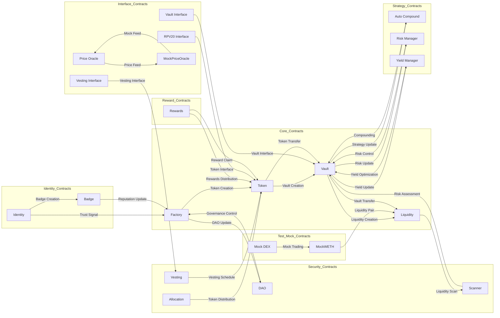

# GIMA RPV Whitepaper

*live from Solidity source code on:* 2026-01-25 19:14:59

## Executive Summary

- **8** Core Contracts
- **4** Security Contracts
- **1** Identity Contracts
- **0** Strategy Contracts
- **1** Reward Contracts
- **7** Interface Contracts
- **3** Test/Mock Contracts

## Protocol Architecture Diagram

## Contract Categories

### Core Contracts

#### `GimaAutoCompound.sol`

**Path:** `contracts\strategies\gimaautocompound.sol`  

**Contract Analysis Report: GimaAutoCompound.sol**

**1. Purpose**: The GimaAutoCompound contract automates the compounding of rewards in a yield farming or liquidity provision scenario, allowing users to earn interest on their deposited assets.

**2. Key functions**:
* `autoCompound(uint256 lockId)`: Compounds the rewards for a specific lock ID, updating the total deposited, compounded, and last compound timestamps.
* `constructor(address _manager, address _rewardToken)`: Initializes the contract with a manager address and a reward token address.
* `onlyManager()`: A modifier function that restricts certain functions to be executed only by the contract manager.

**3. Security considerations**:
* **Reentrancy vulnerability**: The contract does not implement any reentrancy protection mechanisms, making it vulnerable to attacks where an attacker repeatedly calls a function that transfers funds, potentially leading to a loss of funds.
* **Arithmetic overflow**: The contract uses `uint256` for storing and calculating values, which can lead to arithmetic overflows if the values exceed the maximum limit of `uint256`.
* **Lack of access control**: The contract relies on a single `onlyManager` modifier, which may not be sufficient for a production-ready contract. Consider implementing additional access control mechanisms.

**4. Integration points**: The contract imports the `IRPV20` interface, which suggests that it is designed to work with a specific token standard (e.g., RPV20). The contract also depends on the `rewardToken` address, which is set during deployment.

#### `GimaBadge.sol`

**Path:** `contracts\core\gimabadge.sol`  

**GimaBadge Contract Analysis Report**

**1. Purpose**: The GimaBadge contract is a direct permanent lock implementation for a trust badge system, where users can choose to lock their badges permanently and receive a DIAMOND token, which cannot be withdrawn.

**2. Key Functions**:
* `authorizeIssuer(address issuer)`: Adds an issuer to the list of authorized issuers.
* `issueBadge(address token, string badgeId, string badgeConfigId)`: Issues a badge to a token owner and stores the badge information.
* `getBadgeInfo(address token)`: Returns the badge information for a given token owner.
* `getBadgeConfig(string badgeConfigId)`: Returns the badge configuration for a given badge configuration ID.

**3. Security Considerations**:
* **Authorization**: The contract relies on the `authorizedIssuers` mapping to control access to the `issueBadge` function. However, it is essential to ensure that this mapping is properly updated and maintained to prevent unauthorized issuances.
* **Reentrancy**: The contract does not appear to have any obvious reentrancy vulnerabilities, but it is crucial to review the implementation of the `issueBadge` function to ensure that it does not allow for reentrancy attacks.
* **Data Integrity**: The contract stores sensitive information, such as badge configurations and token badge information. It is essential to ensure that this data is properly validated and sanitized to prevent data corruption or tampering.

**4. Integration Points**: The GimaBadge contract depends on the following contracts:
* `IBadge.sol`: The interface contract that defines the badge configuration and badge information structs.
* `factory`: The contract that owns the factory address, which is used to authorize issuers.

#### `GimaRiskManager.sol`

**Path:** `contracts\strategies\gimariskmanager.sol`  

**Contract Analysis Report: GimaRiskManager.sol**

### 1. **Purpose**
The GimaRiskManager contract is designed to manage risk parameters for lending strategies, allowing for customizable settings such as maximum drawdown, minimum health factor, and maximum concentration.

### 2. **Key Functions**
* Initializes risk parameters for different risk levels (e.g., "low", "medium", "high")
* Updates risk parameters for a specific risk level
* Restricts access to only the contract owner through the `onlyOwner` modifier

### 3. **Security Considerations**
* **1.** **Reentrancy vulnerability**: The contract uses a simple `require` statement to check if the sender is the owner, but it does not prevent reentrancy attacks. Consider using a more robust solution, such as `reentrancy` modifier or `check-effects-interactions` pattern.
* **2.** **Data integrity**: The contract stores sensitive data (e.g., risk parameters) in a mapping. Ensure that the data is properly validated and sanitized to prevent potential attacks.
* **3.** **Event emissions**: The contract emits events for risk parameter updates. Ensure that these events are properly handled and secured to prevent information disclosure.

### 4. **Integration Points**
The GimaRiskManager contract does not directly call or depend on other contracts. However, it is likely intended to be used in conjunction with other contracts that manage lending strategies, such as a lending pool or a strategy executor.

#### `GimaTrustFactory.sol`

**Path:** `contracts\core\gimatrustfactory.sol`  

**Contract Analysis Report: GimaTrustFactory.sol**

### 1. **Purpose**
The GimaTrustFactory contract is a deployment manager for Gima Trust tokens, facilitating a 4-stage deployment process with proper token flow.

### 2. **Key Functions**
* **deployToken**: Deploys a new Gima Trust token instance.
* **setTokenFee**: Sets the fee for token deployment.
* **setTokenPriceOracle**: Sets the price oracle for token deployment.
* **verifyToken**: Verifies the token deployment and updates the token's status.

### 3. **Security Considerations**
* **Reentrancy vulnerability**: The contract does not appear to have reentrancy protection, which could lead to potential attacks.
* **Unprotected functions**: Some functions, such as `deployToken`, do not have access control checks, which could allow unauthorized access.
* **Custom errors**: While custom errors are defined, they do not appear to be used consistently throughout the contract.

### 4. **Integration Points**
The GimaTrustFactory contract depends on the following contracts:

* `GimaTrustToken.sol`: The token deployment contract.
* `GimaDAO.sol`: The DAO contract, which is likely used for governance and decision-making.
* `GimaTrustVault.sol`: The vault contract, which is likely used for token storage and management.
* `GimaTrustLiquidity.sol`: The liquidity contract, which is likely used for token liquidity provision.
* `IRPV20.sol`: The interface for the RPV20 token standard.
* `IGimaIdentity.sol`: The interface for the Gima Identity contract.
* `IPriceOracle.sol`: The interface for the price oracle contract.

Note: This analysis is based on the provided contract code and may not be exhaustive. Further review and testing are recommended to ensure the contract's security and functionality.

#### `GimaTrustLiquidity.sol`

**Path:** `contracts\core\gimatrustliquidity.sol`  

**Report: GimaTrustLiquidity.sol Contract Analysis**

**1. Purpose**: The GimaTrustLiquidity contract provides a liquidity management interface for adding liquidity to a universal router, supporting multi-dex operations.

**2. Key functions**:
* `addLiquidity`: Adds liquidity to the universal router, allowing users to provide tokens or ETH in exchange for liquidity.
* `addLiquidityETH`: A variant of `addLiquidity` that specifically adds liquidity using ETH.
* `interface IUniversalRouter`: Defines the interface for interacting with the universal router, enabling multi-dex support.

**3. Security considerations**:
* **Reentrancy vulnerability**: The contract may be vulnerable to reentrancy attacks if not properly protected, as it calls external functions that may modify the contract's state.
* **Front-running attacks**: The use of `deadline` parameters in the `addLiquidity` and `addLiquidityETH` functions may make the contract vulnerable to front-running attacks if not properly validated.
* **Dependency on external contracts**: The contract relies on external contracts (e.g., `IRPV20`, `IPriceOracle`, `ILPToken`, `IVault`) that may have their own security vulnerabilities or implementation issues.

**4. Integration points**:
The contract depends on the following external contracts:
* `IRPV20`
* `IPriceOracle`
* `ILPToken`
* `IVault`
* `GimaBadge` (imported but not used in the provided code snippet)
* `IUniversalRouter` (interface, not a contract)

#### `GimaTrustToken.sol`

**Path:** `contracts\core\gimatrusttoken.sol`  

**Contract Analysis Report: GimaTrustToken.sol**

**1. Purpose**: The GimaTrustToken contract is a Rug-Proof Vault Token implementation with bootstrap support, allowing for the creation and management of a token with vesting schedules and liquidity locks.

**2. Key Functions**:
* `transfer(address recipient, uint256 amount)`: Transfers a specified amount of tokens to a recipient.
* `approve(address spender, uint256 amount)`: Approves a spender to transfer a specified amount of tokens on behalf of the owner.
* `vest(address account, uint256 amount, uint256 unlockTime)`: Creates a vesting schedule for a specified account, allowing them to unlock tokens at a specified time.
* `lockLiquidity(uint256 amount, uint256 lockTime)`: Locks a specified amount of liquidity for a specified time.

**3. Security Considerations**:
* **Reentrancy vulnerability**: The contract does not appear to have reentrancy protection, making it vulnerable to attacks where an attacker repeatedly calls a function that transfers funds, causing the contract to re-enter itself.
* **Front-running attacks**: The contract's use of `transfer` and `approve` functions may make it vulnerable to front-running attacks, where an attacker quickly executes a transaction before a legitimate transaction is confirmed.
* **Lack of access control**: The contract does not appear to have any access control mechanisms, making it vulnerable to unauthorized access and manipulation.

**4. Integration Points**:
* The contract imports the `IRPV20` interface, suggesting that it is designed to be compatible with a specific token standard.
* The contract uses the `GimaTrustDataTypes` struct, which is likely defined in a separate contract or library.
* The contract appears to be designed to work with a "factory" contract, which is likely responsible for creating and managing instances of the GimaTrustToken contract.

#### `GimaTrustVault.sol`

**Path:** `contracts\core\gimatrustvault.sol`  

**Contract Analysis Report: GimaTrustVault.sol**

**1. Purpose**: 
The GimaTrustVault contract is a permanent lock system that allows users to lock their tokens and receive a DIAMOND badge, preventing them from withdrawing their locked assets.

**2. Key Functions**:
* `lockTokens()`: Locks a specified amount of tokens for a user, assigning a badge and setting a lock duration.
* `getBadge()`: Returns the badge ID associated with a user's lock.
* `getLockInfo()`: Retrieves information about a user's lock, including the lock duration, unlock time, and badge ID.
* `withdrawLockedTokens()`: Allows a user to withdraw their locked tokens, but only if the lock has not expired and the user has not withdrawn before.

**3. Security Considerations**:
* **Reentrancy vulnerability**: The contract does not appear to have any reentrancy protection, which could allow an attacker to drain the contract's funds.
* **Timestamp manipulation**: The contract uses a timestamp to determine when a lock expires, which could be manipulated by an attacker to extend the lock duration.
* **Insufficient access control**: The contract does not appear to have any access control mechanisms in place, which could allow unauthorized users to interact with the contract.

**4. Integration Points**:
* `IVault`: The contract implements the IVault interface, which suggests that it is part of a larger system that uses this interface.
* `IBadge`: The contract imports the IBadge interface, which is used to manage badges associated with user locks.
* `ILPToken`: The contract imports the ILPToken interface, which is used to interact with LP tokens.
* `IPriceOracle`: The contract imports the IPriceOracle interface, which is used to retrieve price information.

#### `GimaYieldManager.sol`

**Path:** `contracts\strategies\gimayieldmanager.sol`  

**GimaYieldManager Contract Analysis Report**

**1. Purpose**: The GimaYieldManager contract is designed to manage yield positions and interact with Aave pool and LP token contracts to optimize yield earnings.

**2. Key functions**:
* `deposit()` function to deposit assets into Aave pool on behalf of the yield position.
* `withdraw()` function to withdraw assets from Aave pool and update the yield position.
* `harvest()` function to calculate and distribute yield earnings to the yield position.
* `updateStrategyConfig()` function to update the strategy configuration for a given yield position.

**3. Security considerations**:
* **Reentrancy vulnerability**: The contract uses the `nonReentrant` modifier, but it's essential to ensure that all external calls are properly handled to prevent reentrancy attacks.
* **Front-running attacks**: The contract relies on Aave pool and LP token contracts, which may be vulnerable to front-running attacks. It's crucial to monitor and mitigate potential front-running risks.
* **Unvalidated user input**: The contract does not validate user input for certain parameters, such as `strategyAddress` and `lpTokenAddress`. It's essential to add input validation to prevent potential attacks.

**4. Integration points**:
* `IVault` contract: The contract imports and uses the `IVault` interface, which suggests that it interacts with a vault contract to manage assets.
* `ILPToken` contract: The contract imports and uses the `ILPToken` interface, which suggests that it interacts with an LP token contract to manage liquidity.
* `IAavePool` contract: The contract imports and uses the `IAavePool` interface, which suggests that it interacts with an Aave pool contract to manage assets and earn yield.

### Security Contracts

#### `GimaDAO.sol`

**Path:** `contracts\security\gimadao.sol`  

**GimaDAO.sol Contract Analysis Report**

### 1. **Purpose**
The GimaDAO contract implements a simplified single-proposal governance system for compliance, technical execution, and governance with instant verification.

### 2. **Key Functions**
* **createProposal**: Creates a new proposal with a specified type and description.
* **castVote**: Allows users to cast votes on existing proposals.
* **executeProposal**: Executes a proposal if it has been approved by a majority of votes.

### 3. **Security Considerations**
* **Reentrancy vulnerability**: The contract does not appear to have any reentrancy protection mechanisms in place, which could allow an attacker to drain the contract's balance by repeatedly calling the `executeProposal` function.
* **Front-running attacks**: The contract's use of instant verification may make it vulnerable to front-running attacks, where an attacker can manipulate the order of transactions to gain an unfair advantage.
* **Lack of access control**: The contract does not appear to have any access control mechanisms in place, which could allow unauthorized users to create proposals or cast votes.

### 4. **Integration Points**
The GimaDAO contract imports and depends on the following contracts/interfaces:

* `IRPV20`: An interface for a token contract, likely used for governance token management.
* `IGimaIdentity`: An interface for user identity management, likely used to verify user identities and ensure that only authorized users can create proposals and cast votes.

#### `GimaTrustAllocation.sol`

**Path:** `contracts\security\gimatrustallocation.sol`  

**GimaTrust Allocation Manager Contract Analysis Report**

**1. Purpose**: The GimaTrust Allocation Manager contract is responsible for managing token allocation and distribution with vesting, handling 60% of the total distribution.

**2. Key functions**:
* `addAllocationCategory`: adds a new allocation category
* `updateAllocationCategory`: updates an existing allocation category
* `distributeTokens`: distributes tokens to beneficiaries based on their allocation categories
* `claimTokens`: allows beneficiaries to claim their vested tokens

**3. Security considerations**:
* **Reentrancy vulnerability**: the contract may be vulnerable to reentrancy attacks if not properly protected (e.g., using `reentrancyGuard` or `nonReentrant` modifier)
* **Unprotected external calls**: the contract makes external calls to other contracts without proper validation or error handling
* **Lack of access control**: the contract does not have proper access control mechanisms in place, which may lead to unauthorized modifications or access to sensitive data

**4. Integration points**:
* `IRPV20`: an interface for a token contract (e.g., ERC-20)
* `IVestingManager`: an interface for a vesting manager contract (e.g., a contract responsible for managing vesting schedules)
* `Factory`: a separate contract that keeps 40% of the total distribution for liquidity purposes (not shown in the provided code snippet)

#### `GimaTrustScanner.sol`

**Path:** `contracts\security\gimatrustscanner.sol`  

**Report: GimaTrustScanner.sol**

**1. Purpose**: The GimaTrustScanner contract is designed to scan and evaluate the trustworthiness of tokens, providing a comprehensive report on their trust score, liquidity, and security features.

**2. Key functions**:
* `scanToken()`: Scans a token and generates a report on its trustworthiness.
* `getTokenReport(address tokenAddress)`: Retrieves a token's report by its address.
* `updateReport(address tokenAddress, TokenReport report)`: Updates a token's report.
* `getTrustScore(address tokenAddress)`: Returns a token's trust score.

**3. Security considerations**:
* **Reentrancy vulnerability**: The contract may be vulnerable to reentrancy attacks if not properly protected (e.g., using `reentrancyGuard` or `nonReentrant` modifier).
* **Denial of Service (DoS)**: The contract may be susceptible to DoS attacks if the `getTokenReport` function is called with a large number of token addresses, causing a significant gas cost.
* **Data integrity**: The contract relies on external contracts (e.g., `GimaTrustVault`, `GimaDAO`) for data, which may introduce data integrity issues if not properly validated.

**4. Integration points**:
The contract depends on the following contracts:
* `GimaTrustVault.sol`: For trust score and liquidity data.
* `GimaDAO.sol`: For DAO approval and status data.
* `GimaIdentity.sol`: For identity status data.
* `GimaTrustFactory.sol`: For trust factory data.
* `IRPV20.sol`: For token data (not clear how it's used, but it's imported).

Note: The contract imports `GimaBadge.sol` but does not appear to use it directly. It's possible that it's used indirectly or will be used in the future.

#### `GimaTrustVesting.sol`

**Path:** `contracts\security\gimatrustvesting.sol`  

**Report: GimaTrustVesting.sol**

### 1. **Purpose**
The GimaTrustVesting contract is a combined allocation management and vesting schedule manager that handles token distribution and vesting rules for beneficiaries.

### 2. **Key functions**
* `createVestingSchedule`: creates a vesting schedule for a beneficiary with specified token details and vesting rules.
* `allocateTokens`: allocates tokens to beneficiaries based on their allocation categories.
* `distributeTokens`: distributes tokens to beneficiaries according to their allocation categories and vesting schedules.
* `updateVestingSchedule`: updates an existing vesting schedule for a beneficiary.

### 3. **Security considerations**
* **Reentrancy vulnerability**: the contract does not appear to have any reentrancy protection, which could allow an attacker to drain funds by repeatedly calling the `transfer` function.
* **Unprotected external calls**: the contract calls external functions without checking the return values, which could lead to unexpected behavior or errors.
* **Lack of access control**: the contract does not have any access control mechanisms, which could allow unauthorized users to modify the vesting schedules or allocate tokens.

### 4. **Integration points**
The contract depends on the following external contracts and interfaces:

* `IRPV20`: an interface for a token contract, which is used for token allocation and vesting.
* `IVestingManager`: an interface for a vesting manager contract, which is used for creating and managing vesting schedules.
* `AllocationCategory`: a struct that represents an allocation category, which is used to store information about token allocations and vesting rules.
* `beneficiaries`: an array of addresses that represent the beneficiaries of the token allocations.

### Identity Contracts

#### `GimaIdentity.sol`

**Path:** `contracts\identity\gimaidentity.sol`  

**GimaIdentity Contract Analysis Report**

**1. Purpose**: The GimaIdentity contract is a simplified identity system that utilizes the DAO approval threshold to manage user identities and social handles.

**2. Key functions**:
* `createIdentityRecord`: Creates a new identity record for a user.
* `updateIdentityRecord`: Updates an existing identity record.
* `verifyIdentity`: Verifies a user's identity through DAO approval.
* `revokeIdentity`: Revokes a user's identity.

**3. Security considerations**:
* **DAO approval threshold**: The contract relies on the DAO's approval threshold, which may be vulnerable to manipulation or exploitation if not properly secured.
* **Identity hash and universal ID**: The contract stores sensitive user information (identity hash and universal ID), which should be properly secured and protected from unauthorized access.
* **Lack of access control**: The contract does not implement robust access control mechanisms, which may lead to unintended behavior or security vulnerabilities.

**4. Integration points**: The GimaIdentity contract depends on the following contracts:
* `GimaDAO`: The DAO contract is responsible for managing the approval threshold and verifying user identities.
* `IRPV20`: The RPV20 contract is likely responsible for managing the RPV20 token, which may be used for identity verification or other purposes.
* `IPriceOracle`: The price oracle contract may be used to retrieve price data for identity verification or other purposes.
* `IGimaIdentity`: The IGimaIdentity interface is implemented by the GimaIdentity contract, indicating that it is a part of a larger identity protocol.

### Reward Contracts

#### `GimaRewards.sol`

**Path:** `contracts\rewards\gimarewards.sol`  

**GimaRewards Contract Analysis Report**

**1. Purpose**: The GimaRewards contract is designed to manage user rewards, track points, and facilitate token redemption for users.

**2. Key functions**:
* `getRewardsForUser(address user)`: Returns the user's rewards data.
* `claimRewards(address user)`: Allows a user to claim their pending rewards.
* `updatePoints(address user, uint256 points)`: Updates a user's points balance.
* `lockDiamond(address user, uint256 amount)`: Locks a user's diamond amount for a specified duration.

**3. Security considerations**:
* **Reentrancy vulnerability**: The contract does not appear to have reentrancy protection, which could allow an attacker to drain funds by repeatedly calling the `claimRewards` function.
* **Unprotected state variables**: The `userRewards` and `diamondLockAmounts` mappings are publicly accessible, which could allow an attacker to manipulate user data.
* **Potential front-running attacks**: The contract does not appear to have any mechanisms to prevent front-running attacks, which could allow an attacker to manipulate user rewards by submitting multiple transactions in quick succession.

**4. Integration points**: The GimaRewards contract depends on the following contracts:

* `IVault`: The vault contract is used to store and manage user funds.
* `IRPV20`: The IRPV20 contract is used to represent the reward token (e.g. GimaTrust token).

To improve the security of this contract, I would recommend implementing reentrancy protection, protecting state variables with access control, and adding mechanisms to prevent front-running attacks. Additionally, it would be beneficial to review the contract's logic and ensure that it accurately reflects the intended behavior.

### Interface Contracts

#### `IBadge.sol`

**Path:** `contracts\interfaces\ibadge.sol`  

**IBadge.sol Contract Analysis Report**

### 1. **Purpose**
The IBadge.sol contract serves as an interface for the GimaTrust Badge System, providing a standardized way for other contracts to interact with the badge issuance, upgrade, revocation, and flagging processes.

### 2. **Key functions**
* **Badge Issuance**: Issues a new badge with a specified lock duration, trust score, and expiry date.
* **Badge Upgrade**: Upgrades an existing badge to a new version with updated lock duration and trust score.
* **Badge Revocation**: Revokes a badge due to a specified reason.
* **Suspicious Token Flagging**: Flags a token address as suspicious due to a specified reason.

### 3. **Security considerations**
* **Event emissions**: The contract emits events for various actions, which could potentially reveal sensitive information. Ensure that event emissions are properly handled and audited.
* **Lack of access control**: The contract does not implement access control mechanisms, which could lead to unauthorized modifications or revocations. Consider adding access control features to restrict interactions.
* **Permanent lock activation**: The contract mentions a permanent lock activation event, but its implementation is not provided. Ensure that this feature is properly implemented and audited.

### 4. **Integration points**
The IBadge.sol contract does not directly call or depend on other contracts. However, it is likely intended to be used as an interface for other contracts that will interact with the GimaTrust Badge System. As such, it may be integrated with contracts that manage token addresses, badge metadata, and access control mechanisms.

#### `IGimaIdentity.sol`

**Path:** `contracts\interfaces\igimaidentity.sol`  

**Report: IGimaIdentity.sol**

**1. Purpose**: The IGimaIdentity contract is an interface for a simplified identity system, providing a standardized way to manage user identities and their associated metadata.

**2. Key functions**:
* **Identity creation**: Creates a new identity for a user, emitting an `IdentityCreated` event.
* **Identity revocation**: Revokes an existing identity for a user, emitting an `IdentityRevoked` event.
* **Identity approval by DAO**: Allows a DAO to approve or reject an identity, emitting an `IdentityApprovedByDAO` event.
* **Nonce management**: Manages a user's nonce, emitting a `NonceUsed` event when a nonce is used.

**3. Security considerations**:
* **Reentrancy vulnerability**: The contract does not appear to implement reentrancy protection, making it vulnerable to reentrancy attacks.
* **Unprotected events**: The contract emits events without proper validation, which could lead to unintended behavior or security issues.
* **Lack of access control**: The contract does not implement access control mechanisms, making it vulnerable to unauthorized access or modifications.

**4. Integration points**: The contract depends on the following external contracts or systems:
* **DAO contract**: The contract interacts with a DAO contract to approve or reject identities.
* **User authentication system**: The contract assumes the existence of a user authentication system to verify user identities.
* **Blockchain storage**: The contract relies on the blockchain's storage capabilities to store identity metadata.

#### `ILPToken.sol`

**Path:** `contracts\interfaces\ilptoken.sol`  

**ILPToken.sol Contract Analysis Report**

### 1. **Purpose**
The ILPToken contract is an interface for LP tokens, specifically designed to be compatible with Uniswap V2, providing a standardized way to interact with liquidity pool tokens.

### 2. **Key functions**
* `totalSupply()`: Returns the total supply of the LP token.
* `balanceOf(address account)`: Returns the balance of a specific account.
* `transfer(address recipient, uint256 amount)`: Transfers a specified amount of tokens to a recipient.
* `approve(address spender, uint256 amount)`: Approves a spender to transfer a specified amount of tokens.

### 3. **Security considerations**
* **Reentrancy vulnerability**: The `transfer` and `transferFrom` functions do not have reentrancy protection, which could allow an attacker to drain the contract's funds.
* **Allowance overflow**: The `approve` function does not check for overflow when setting the allowance, which could lead to unexpected behavior.
* **Lack of access control**: The interface does not implement any access control mechanisms, which could allow unauthorized users to interact with the contract.

### 4. **Integration points**
The ILPToken contract depends on the following contracts/interfaces:

* ERC-20 standard contracts (e.g., ERC20.sol)
* Uniswap V2 contracts (e.g., UniswapV2Pair.sol)

Note that the contract is an interface, so it does not have any implementation and relies on the underlying contracts to provide the necessary functionality.

#### `IPriceOracle.sol`

**Path:** `contracts\interfaces\ipriceoracle.sol`  

**Contract Analysis Report: IPriceOracle.sol**

**1. Purpose**: The IPriceOracle contract provides an interface for retrieving token values in USD, enabling users to get the current price of tokens and liquidity pool (LP) values.

**2. Key functions**:
* `getLPValueInUSD(address lpToken, uint256 amount)`: Returns the value of a specified LP token in USD.
* `getTokenPrice(address token)`: Returns the current price of a specified token in USD.
* `getLPBreakdown(address lpToken, uint256 amount)`: Returns a breakdown of the LP token's composition, including token amounts and values in USD.

**3. Security considerations**:
* **View functions**: All functions are marked as `view`, which means they do not modify the contract state. However, it's essential to ensure that these functions do not reveal sensitive information that could be used for front-running or other malicious activities.
* **External dependencies**: The contract relies on external data sources for token prices and LP values, which may introduce security risks if these sources are compromised or unreliable.
* **Potential reentrancy**: Although the contract uses `view` functions, it's still possible for reentrancy attacks if the functions are not properly implemented or if the external dependencies are not secure.

**4. Integration points**:
* The contract does not directly call or depend on other contracts. However, it's likely that it will be used in conjunction with other contracts that interact with token prices and LP values, such as liquidity pool contracts or decentralized exchanges (DEXs).

#### `IRPV20.sol`

**Path:** `contracts\interfaces\irpv20.sol`  

**IRPV20 Contract Analysis Report**

**1. Purpose**: The IRPV20 contract is an interface for a token standard that extends the ERC-20 standard with enhanced security features, including vesting schedules, token release events, and liquidity locking.

**2. Key functions**:
* Emits events for standard ERC-20 transactions (transfer and approval)
* Emits events for GimaTrust-specific transactions (vesting schedule creation, token release, and liquidity locking)
* Defines the structure for vesting schedules, token releases, and liquidity locking

**3. Security considerations**:
* The contract relies on external contracts for implementation, which may introduce security risks if not properly audited and maintained
* The use of events for tracking transactions may lead to gas optimization issues if not properly handled
* The contract's structure and functionality may be vulnerable to reentrancy attacks if not properly implemented

**4. Integration points**: The IRPV20 contract likely depends on other contracts that implement the following functionality:
* Token implementation (e.g., a contract that inherits from IRPV20 and provides the actual token logic)
* Vesting schedule management (e.g., a contract that manages vesting schedules and token releases)
* Liquidity locking (e.g., a contract that manages liquidity locking and unlocking)
* Trust score management (e.g., a contract that updates and manages trust scores)

Note that the contract is an interface, so it does not contain any implementation. The actual implementation of the token standard and its features would be in a separate contract that inherits from IRPV20.

#### `IVault.sol`

**Path:** `contracts\interfaces\ivault.sol`  

**IVault.sol Contract Analysis Report**

### 1. **Purpose**
The IVault contract is an interface for the Gima Trust Vault, providing a complete interface with permanent lock functionality.

### 2. **Key Functions**
* `LPLock` struct definition: a data structure to represent a liquidity pool lock.
* `LPLocked` event emission: triggered when a liquidity pool lock is created.
* (No functions are defined in this interface, as it is an interface and not a contract)

### 3. **Security Considerations**
* **1. Lack of Functionality**: As an interface, this contract does not contain any executable code, which reduces the attack surface. However, it is still essential to ensure that the contracts that implement this interface are secure.
* **2. External Dependencies**: The contract relies on external contracts for token and liquidity pool token addresses, which can introduce security risks if not properly validated.
* **3. Event Emission**: The `LPLocked` event emission does not have any security implications, but it is essential to ensure that the event is properly emitted and handled by the implementing contracts.

### 4. **Integration Points**
The IVault contract does not call or depend on any other contracts. However, it is likely that the contracts that implement this interface will depend on other contracts, such as token and liquidity pool token contracts, to retrieve the necessary addresses.

**Recommendations**

* Ensure that the contracts that implement this interface are secure and properly validated.
* Verify that the event emission is properly handled by the implementing contracts.
* Consider adding additional functionality to this interface, such as lock management functions, to enhance its utility.

#### `IVestingManager.sol`

**Path:** `contracts\interfaces\ivestingmanager.sol`  

**IVestingManager.sol Contract Report**

**1. Purpose**: The IVestingManager contract is designed to manage vesting schedules for token distributions, allowing for the creation of customized release periods for beneficiaries.

**2. Key functions**:
* `createVestingSchedule`: Creates a vesting schedule for a beneficiary, specifying the token address, amount, cliff months, and duration months.
* `createVestingScheduleWithReturn`: Creates a vesting schedule with an additional return address, allowing for the return of excess tokens.

**3. Security considerations**:
* **Reentrancy vulnerability**: The contract does not appear to implement any reentrancy protection, which could allow an attacker to drain funds by repeatedly calling the contract's functions.
* **Lack of access control**: The contract does not implement any access control mechanisms, which could allow unauthorized users to create vesting schedules.
* **Potential for token manipulation**: The contract does not enforce any token balance checks, which could allow an attacker to create vesting schedules for non-existent tokens.

**4. Integration points**: The IVestingManager contract depends on the following contracts:

* Token contracts (e.g., ERC20): The contract assumes the existence of a token contract, which is used to manage the token distribution.
* Other vesting schedule contracts: The contract may be used in conjunction with other vesting schedule contracts to manage complex token distribution scenarios.

Note: The contract is an interface, which means it only defines function signatures and does not provide any implementation. The actual implementation of the contract's functions would be provided by a separate contract that implements this interface.

### Test/Mock Contracts

#### `CompleteMockDEX.sol`

**Path:** `contracts\core\completemockdex.sol`  

**Contract Analysis Report: CompleteMockDEX.sol**

### 1. **Purpose**
The CompleteMockDEX contract is a mock implementation of a liquidity pool token (LPToken) that can be used for testing purposes.

### 2. **Key Functions**
* Initializes the LPToken with two underlying tokens (_token0 and _token1) and a factory address (_factory).
* Manages the reserves of the two underlying tokens (_reserve0 and _reserve1).
* Implements ERC20 functionality for balance and allowance management.

### 3. **Security Considerations**
* **1. Reentrancy vulnerability**: The contract does not appear to implement reentrancy protection, which could allow an attacker to drain the contract's funds.
* **2. Lack of access control**: The contract does not have any access control mechanisms in place, which could allow unauthorized users to manipulate the contract's state.
* **3. Potential overflow**: The contract uses uint112 and uint256 variables, which could lead to overflows if the values exceed the maximum limit.

### 4. **Integration Points**
The contract imports the following interfaces and contracts:

* `ILPToken`: an interface for liquidity pool tokens.
* `IRPV20`: an interface for a token with a 20% royalty.
* `MockWETH`: a mock implementation of the Wrapped Ether (WETH) token.
* `MockLPToken` itself is likely to be used in conjunction with other contracts that interact with liquidity pools, such as a DEX (Decentralized Exchange) contract.

#### `MockPriceOracle.sol`

**Path:** `contracts\core\mockpriceoracle.sol`  

**Contract Analysis Report: MockPriceOracle.sol**

**1. Purpose**: The MockPriceOracle contract is a testing utility that provides a mock price oracle implementation with enhanced default pricing and error handling.

**2. Key Functions**:
* `constructor()`: Initializes the contract with default prices and sets up the price feeds.
* `tokenPrices(address)`: Returns the price of a given token.
* `priceFeeds(address)`: Returns the price feed for a given token.

**3. Security Considerations**:
* **Reentrancy vulnerability**: The contract does not appear to have any reentrancy protection, which could allow an attacker to drain funds from the contract.
* **Unprotected mapping access**: The `tokenPrices` and `priceFeeds` mappings are publicly accessible, which could allow an attacker to manipulate the prices or feeds.
* **Lack of input validation**: The contract does not validate user input, which could lead to unexpected behavior or errors.

**4. Integration Points**: The contract calls/depends on the following contracts/interfaces:
* `IPriceOracle`: The contract implements the `IPriceOracle` interface, which suggests that it is designed to be used with other contracts that rely on this interface.
* `LPData`: The contract uses a custom struct `LPData` to store LP token data, which is not a standard contract or interface.

#### `MockWETH.sol`

**Path:** `contracts\core\mockweth.sol`  

**MockWETH Contract Analysis Report**

### Purpose
The MockWETH contract is a mock implementation of the Wrapped Ether (WETH) token, allowing for testing and development purposes.

### Key Functions
* `deposit()`: Allows users to deposit Ether into their account, incrementing their balance and the total supply.
* `withdraw(uint256 amount)`: Allows users to withdraw a specified amount of Ether from their account.
* `balanceOf(address account)`: Returns the balance of a specified account.
* `allowance(address owner, address spender)`: Returns the allowance of a specified spender for a specified owner.

### Security Considerations
* **Reentrancy vulnerability**: The `withdraw` function does not check for reentrancy attacks, which could allow an attacker to drain the contract's funds.
* **Insufficient input validation**: The `withdraw` function does not validate the input amount, which could lead to incorrect or malicious behavior.
* **Lack of access control**: The contract does not implement any access control mechanisms, which could allow unauthorized users to interact with the contract.

### Integration Points
The MockWETH contract depends on the following contracts or external systems:

* `0x`: The contract uses the `address(0)` address, which is the null address in Ethereum.
* `msg.sender`: The contract uses the `msg.sender` variable, which is the address of the user interacting with the contract.
* `msg.value`: The contract uses the `msg.value` variable, which is the amount of Ether sent with the transaction.

Note: The `withdraw` function is incomplete in the provided code snippet, so the analysis is limited to the available information.

## Statistics

| Category | # Contracts |
|----------|-------------|
| Core Contracts | 8 |
| Security Contracts | 4 |
| Identity Contracts | 1 |
| Strategy Contracts | 0 |
| Reward Contracts | 1 |
| Interface Contracts | 7 |
| Test/Mock Contracts | 3 |
| **Total** | **24** |

## Individual Contract Explanations

All contract analyses are also stored as plain‑text files in the `solidity_explanations` directory (one file per contract).

## Conclusion

This doc provides an overview of the GIMA RPV protocol based on the current source code in the repository.

*Generated automatically by the internal auditor – do not consider this a legal audit.*
